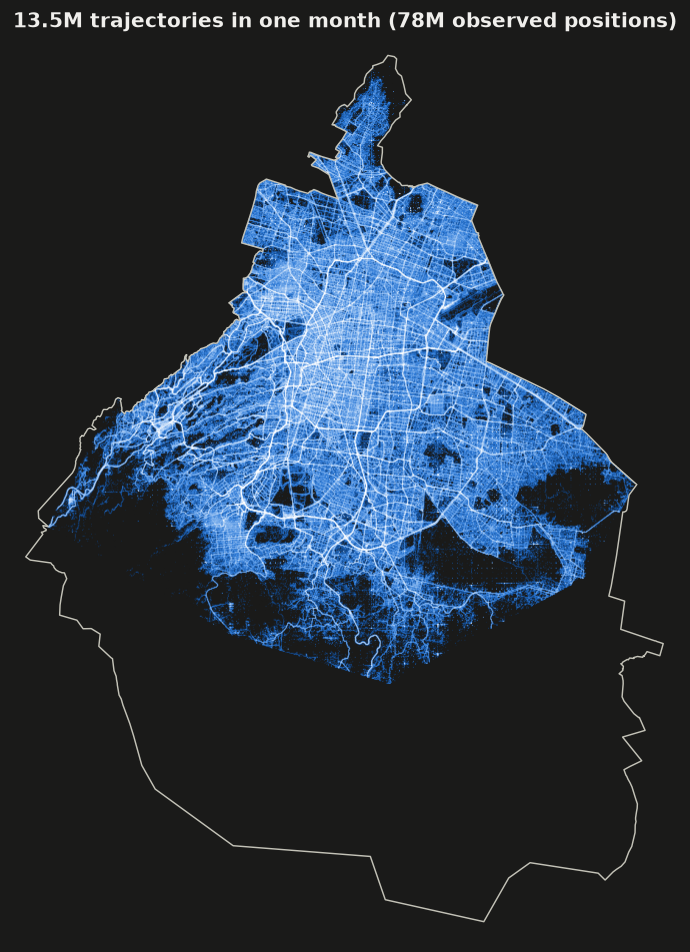

# PolaRoam

<div align="center">
  

  **Mobility pings to stays, trips and homes, with Polars.**

  [Documentation](https://ollin18.github.io/polaroam/) ·
  [Quick start](https://ollin18.github.io/polaroam/getting-started/quickstart/) ·
  [User guide](https://ollin18.github.io/polaroam/guide/) ·
  [Examples](https://ollin18.github.io/polaroam/examples/)
</div>

PolaRoam turns raw location pings (LBS / GPS) into:

- **stays**;
- **trajectories with speeds and transport mode**;
- recurrent **places**;
- **home / work** locations, with k-anonymous **H3 heat maps**.

It uses pure, vectorized [Polars](https://pola.rs): no per-device Python loops. It runs all at
once or day by day, on CPU or CUDA, and follows the logic of the gc-lbs BigQuery pipeline.

- **1.66 billion pings** (a month of Mexico City) in **16 minutes** on one GPU.
- **3.4 GB** peak RAM processing that month **day by day**.
- **Identical tables** whether you process all at once or day by day, on CPU or GPU.



## Install

```bash
pip install -e .                 # polars + numpy
pip install -e ".[tz,cuda]"      # + timezone polygons, GPU engine (cudf-polars >= 26.4)
```

## Quick start

```python
import polaroam as pr

stops, trips = pr.detect_stops("pings/*.parquet", trajectories=True)
places = pr.cluster_stops(stops)                                   # per-device DBSCAN
local = pr.add_local_time(places, timezone="America/Mexico_City")
hw = pr.classify_home_work(local)                                  # H / W / O per stay
trips.select("length_m", "speed_p85_kmh", "speed_cv", "mode_guess", "geometry")
```

The whole pipeline, all at once or day by day:

```python
pipe = pr.Pipeline("out/MX", pr.PipelineConfig(timezone="America/Mexico_City", n_shards=24),
                   trajectories=True, use_cuda=True)
pipe.run("raw/MX/**/*.parquet")                    # or: pipe.update(day) ... pipe.finalize()
```

```bash
polaroam run "raw/MX/**/*.parquet" out/MX --timezone America/Mexico_City --trajectories --cuda
```

## Documentation

Everything is at **<https://ollin18.github.io/polaroam/>**:

- [Stays](https://ollin18.github.io/polaroam/guide/stays/)
- [Clustering](https://ollin18.github.io/polaroam/guide/clustering/)
- [Home and work](https://ollin18.github.io/polaroam/guide/home-work/)
- [Trajectories](https://ollin18.github.io/polaroam/guide/trajectories/)
- [Speed and transport mode](https://ollin18.github.io/polaroam/guide/speed-and-mode/)
- [Heat maps (H3) and data quality](https://ollin18.github.io/polaroam/guide/spatial/)
- [Incremental processing](https://ollin18.github.io/polaroam/guide/incremental/)
- [CUDA](https://ollin18.github.io/polaroam/guide/cuda/)
- [Parity with gc-lbs](https://ollin18.github.io/polaroam/validation/parity/)
- [Benchmarks](https://ollin18.github.io/polaroam/validation/benchmarks/)
- [API reference](https://ollin18.github.io/polaroam/reference/)

Build it locally with `pip install -e ".[docs]" && mkdocs serve`.

## Tests

```bash
pip install -e ".[dev]" && pytest -q
```

## License

MIT.
