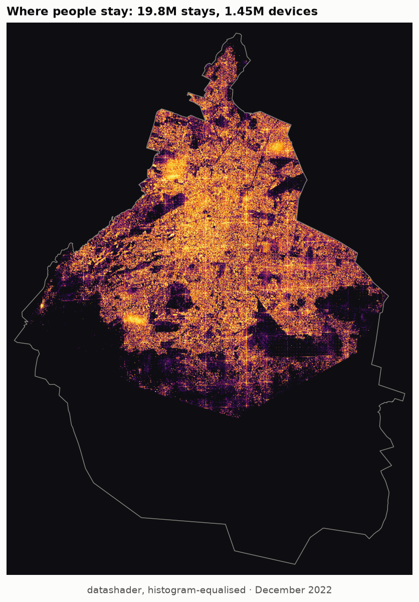
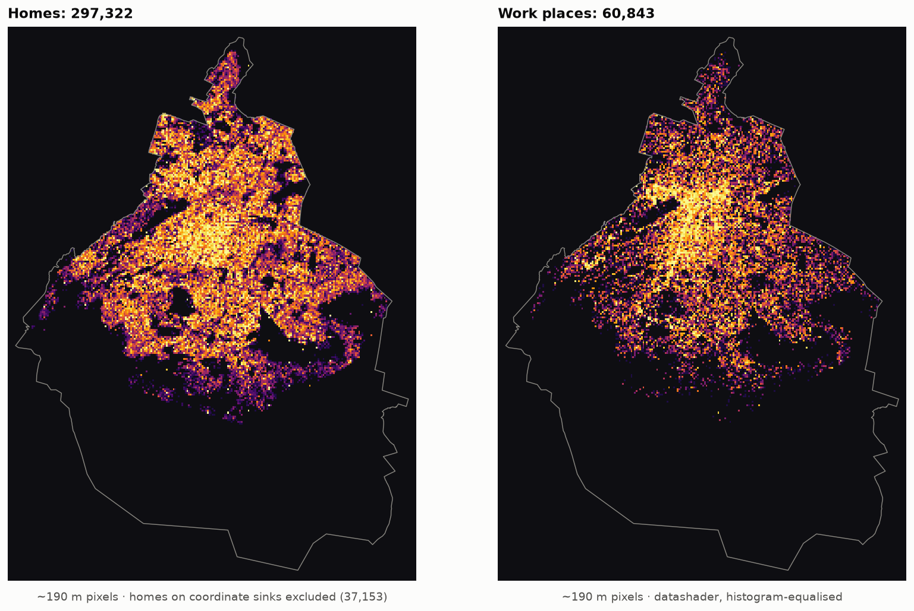
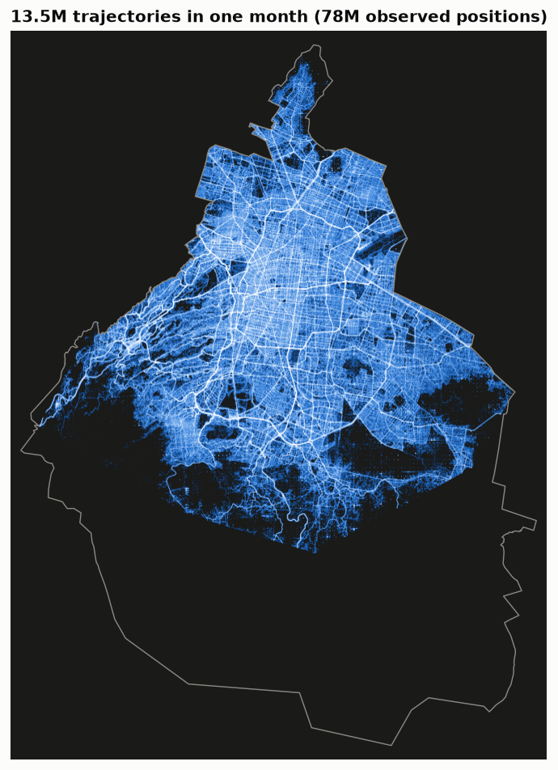
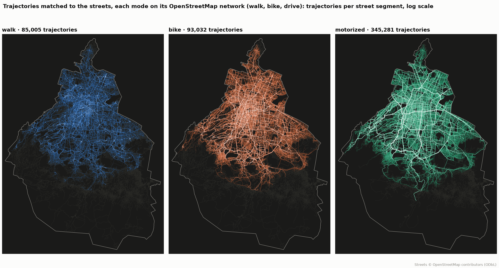
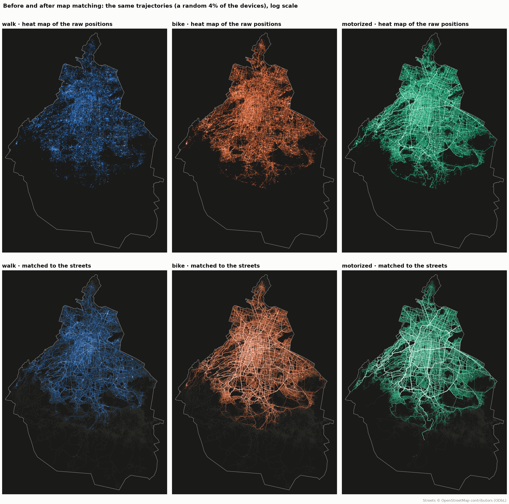

# Mexico City at scale

A full month of location data for Mexico City: **1.66 billion pings from 1.58 million
devices**, December 2022 (the `filtered_localized` quadrant dataset, 22 GB of parquet in 32
daily partitions). The runs use the gc-lbs MX configuration. Maps are clipped to the official
boundary of Ciudad de México (INEGI Marco Geoestadístico, `CVE_ENT = 09`).

!!! note "Coverage"
    The quadrant dataset is a bounding box that ends at 19.198° N. The southern rural part of
    the city (most of Tlalpan, Milpa Alta and Xochimilco) is outside it, so the south of every
    map is empty for lack of data, not because of the clipping.

## Step 1: remove coordinate sinks

Two-thirds of the devices have pings snapped to a handful of exact points: the city's default
geocode at the Zócalo (292k devices on 19.4326, -99.1332, plus a jitter grid around it), cell
towers and Wi-Fi positioning points. These pings create fake stays and homes and pull real
trips into straight lines toward those points. They are found and dropped first
([details](../guide/spatial.md#data-quality-coordinate-sinks)):

```python
import polaroam as pr

sinks = pr.find_sinks("/data/Berkeley/MX/data_quadrant/filtered_localized/*/*.parquet", min_devices=5000)
sinks.write_parquet("mx_sinks.parquet")          # 2,586 coordinates; 104 s
```

| Sinks (≥ 5,000 devices per exact coordinate) | |
|---|---|
| coordinates | 2,586 |
| pings dropped | 263,698,461 (15.9%) |
| devices with at least one dropped ping | 1,036,478 |

## Step 2: the pipeline

```python
cfg = pr.PipelineConfig.from_json(
    "pipeline_config.json", "MX", n_shards=24,
    trajectories=pr.TrajectoryParams(min_pings=2, min_length_m=100),
    remove_sinks="mx_sinks.parquet",     # or remove_sinks=True to find them during the run
    column_map={"timestamp": "utc_date"},  # this dataset's `timestamp` is local time, see below
)
pipe = pr.Pipeline("/data/out/MX_2022_12", cfg, trajectories=True, use_cuda=True)
pipe.run("/data/Berkeley/MX/data_quadrant/filtered_localized/*/*.parquet")
```

14.7 minutes on one RTX 3090, with a peak of 22.1 GB of RAM.

!!! warning "This dataset's `timestamp` is local time"
    In the quadrant data, `timestamp` holds the *local* wall-clock time written as a Unix time
    (`1670275719` reads 21:28:39, the local `date`), while `utc_date` is the real UTC instant.
    Read as UTC, every local time was 6 hours early: stays, trajectories and speeds were
    unaffected (they only use time differences), but the home and work hours were applied to
    the wrong part of the day. The comparison with the official survey below exposed it; the
    run above reads `utc_date`. See [Input data](../guide/input.md#timestamps).

| Output | Without sinks | With sinks (gc-lbs behavior) |
|---|---|---|
| stays | 19,847,489 | 22,391,432 |
| trajectories (≥ 2 pings, ≥ 100 m) | 13,504,251 | 14,307,433 |
| devices with a home | 334,475 | 364,607 |
| devices with a work place | 60,843 | 64,306 |

## Where people stay

All 19.8M stays as points, rendered with [datashader](https://datashader.org) (aggregated per
pixel, histogram-equalised colors) and clipped to the city boundary:

{ width="640" }

## Homes and work places

The home and work location of every device that has one (`pipe.locations()`), same rendering
on ~190 m pixels. Homes on coordinate sinks are excluded. Work places are sparse (61k over the
city): at finer pixels most of them would hold just 1 or 2 points, and histogram equalisation,
which colors pixels by the *rank* of their count, would collapse to two colors.



Homes cover the residential city. Work places concentrate in the business districts, well above
their share of homes:

| Area | Work places | Homes |
|---|---|---|
| Reforma, Juárez, Cuauhtémoc | 5.4% | 2.0% |
| Polanco | 2.6% | 1.0% |
| Centro Histórico | 2.0% | 0.3% |
| Santa Fe | 0.9% | 0.4% |

With local times shifted by 6 hours (see the warning above), the Reforma corridor held only
3.6% of work places: the 8:00–18:00 work window fell on the wrong hours. Work detection uses the
gc-lbs MX thresholds (4 workdays in the month, ≥ 50 m from home); about 18% of the devices with a
home also have a work place in one month. For per-hexagon counts you can join with other data, see [Heat maps
with H3](../guide/spatial.md). Click any figure to enlarge it.

## Trajectories

Every observed position of the 13.5M trajectories (78M points: pings and stay anchors), as a
density raster. The street network appears from movement alone.

{ width="640" }

### By mode

The same, split by the baseline `mode_guess`:


- **Motorized** trips trace the road hierarchy: Periférico, Circuito Interior, Calzada de
  Tlalpan, Viaducto.
- **Bike** trips are densest in the center.
- **Walk** trips are local and diffuse.

| Mode | Trajectories | Median p85 | Median length |
|---|---|---|---|
| motorized | 5,825,143 | 40.7 km/h | 4.5 km |
| unknown | 4,587,279 | | 0.5 km |
| bike | 1,588,679 | 13.1 km/h | 1.5 km |
| walk | 1,503,150 | 1.3 km/h | 0.3 km |


!!! warning "Reading the mode baseline"
    - **Motorized** and **bike** have plausible cruising speeds and lengths.
    - **`walk`** has a median p85 of 1.3 km/h, below real walking: much of it is slow movement
      or drift near places.
    - **The longest motorized trips** (100+ km) are real: 4–8-hour drives at ~24 km/h, with no
      jumps, all over the city. These are the signature of taxi, ride-hailing and delivery
      drivers who never stop for the 5 minutes a stay needs.

    `mode_guess` is a baseline and a feature set, not ground truth. See [Speed and transport
    mode](../guide/speed-and-mode.md).

### Snapped to the streets

The maps above draw where the pings are. [Map matching](../guide/map-matching.md) snaps each
trajectory to the street network it can use, so it follows real streets and tells which street
segments it traversed. Each mode is matched on its own OpenStreetMap network: walkers on
footpaths and pedestrian streets, cyclists on the bike network, motorized trips on the drive
network with its one-way streets.

```python
# a random 4% of the devices, their trajectories with every ping
trips = pr.extract_trajectories(pings, stops, simplify_tolerance=0, min_pings=2, min_length_m=100,
                                remove_sinks="mx_sinks.parquet")
nets = {m: pr.RoadNetwork(pl.read_parquet(f"osm/{k}.parquet"), directed=True)
        for m, k in [("walk", "walk"), ("bike", "bike"), ("motorized", "drive")]}
res = pr.match_trajectories(trips, nets)
vol = pr.edge_volumes(res.edges, by="mode_guess", min_fraction=0.5)
```



The same trajectories before matching, as a heat map of their raw positions (top), and after
(bottom): matching turns a cloud of noisy points into specific streets, and separates the busy
corridors from the streets next to them.



| Mode | Network (OSM) | Trajectories | Points matched | In one piece | No matched line | Median distance to the road |
|---|---|---|---|---|---|---|
| motorized | drive: 125,606 nodes, 295,154 edges | 370,618 | 93.0% | 87.1% | 6.8% | 8.7 m |
| bike | bike: 163,318 nodes, 379,006 edges | 101,324 | 93.2% | 89.6% | 8.2% | 8.9 m |
| walk | walk: 192,068 nodes, 535,444 edges | 95,575 | 93.1% | 88.6% | 11.1% | 11.3 m |

- **Motorized** trips concentrate on the road hierarchy: Periférico, Circuito Interior,
  Viaducto, Insurgentes, Calzada de Tlalpan.
- **Bike** trips spread over the whole grid, densest in the center.
- **Walk** trips stay local: many streets, few trips each.
- "No matched line": short trajectories (median 6 points) with at most one ping within 80 m of
  the mode's network, so there is nothing to connect.

Matching the 567,517 trajectories (11.7M points) on the three networks took 8.8 minutes on 32
CPU cores. The script peaked at 32 GB of RAM, most of it the results kept in memory: the
traversed-edges table alone has 46.6M rows (6 GB). Matching all the walk trajectories alone
peaks at 5.7 GB. For larger runs, match in batches (a day, or a shard of devices) and write
each result.

## Checked against the official survey

The [Origin-Destination Survey 2017](https://www.inegi.org.mx/programas/eod/2017/) (EOD, INEGI)
asked households in the metropolitan area about every trip of a weekday: modes used, start and
end time, origin and destination district (194 districts). Both sources are restricted to
weekday trips with origin and destination in the 80 Mexico City districts covered by the LBS
data; survey trips are weighted by their expansion factors. A survey trip counts as `walk` if
walking was its only mode, `bike` if it used a bicycle (or bicitaxi) and no motorized mode, and
`motorized` otherwise.

**A trajectory is not a trip.** Taken as they are, 6% of the LBS trajectories start between
midnight and 5:00, against 0.4% of the surveyed trips. The start times are right; what starts at
night is mostly not travel: 68% of those trajectories end where they started (vs 46% in the
day) and 22% contain GPS jumps (vs 13%), the trace of a phone lying still while its position
hops between Wi-Fi or cell fixes (15% of all pings are sent between midnight and 6:00). The
holiday season adds real night trips at the end of the month. So the LBS side counts **trips**:
trajectories that go from one stay to another, move at least 200 m and have no GPS jumps, on
regular weekdays (2–22 December, without the 12th, the night of the pilgrimage to the Basílica).
That leaves 329,015 trips, of which 0.3–1% start in each night hour, like in the survey.


| | EOD 2017 | LBS Dec 2022 | Agreement |
|---|---|---|---|
| District-to-district flows (all modes) | | | Spearman ρ = **0.77** (6,009 pairs) |
| Motorized share / trips per origin district | 68.4% | 69.1% | ρ = **0.85** |
| Bike share / trips per origin district | 1.6% | 22.5% | ρ = 0.30 |
| Walk share / trips per origin district | 30.1% | 8.3% | ρ = −0.02 |
| Start hour profile (walk / bike / motorized) | | | r = 0.59 / 0.57 / 0.56 |
| Median duration, motorized | 45 min (door to door) | 36 min (moving) | |

What this says:

- **Motorized travel is right.** Its share matches the survey, and district-to-district flows
  and motorized origins rank the districts like the survey does.
- **The `bike` class is not cycling.** It is fourteen times the official cycling share. Most of
  it is likely slow motorized movement (congested traffic, buses), which speed rules cannot
  tell from a bicycle. `mode_guess` is a baseline; separating buses, cars and bicycles needs
  context such as transit routes (see [Speed and mode](../guide/speed-and-mode.md)).
- **Walking is undercounted and in the wrong places.** Its share is far lower than the
  survey's, and its origins do not correlate with the survey's at all. Short walks rarely end
  in a stay of 5 minutes or more 200 m away, and have few pings.
- **Timing is broadly right.** Night trips are as rare as in the survey and the evening peak
  matches; the LBS data lacks the sharp 7:00 morning peak and has more late-evening trips.
- **Durations differ by definition**: a survey trip is door to door (with walking and
  waiting), an LBS trip is the movement between two stays.

The comparison is indicative: 2017 vs December 2022, reported trips vs app-location
trajectories.

## How trajectories were fixed along the way

Two artifacts were found in this data and fixed in the library:

1. **Ping-pong between the true position and a fallback point, within minutes.** It produced
   103k "walks" longer than 100 km: median 3.4 minutes, 18 jumps each, straightness ≈ 0. GPS
   jumps (faster than `max_speed_kmh`) now split trajectories like long gaps do.
2. **Snapping to sink points at plausible speeds.** This drew straight spokes toward the sinks
   in the walk and bike maps. It is fixed at the source with `remove_sinks`.

After both fixes, the longest walk is 34 km (it was 76,000 km), with a p99 of 6.7 km.

## Three ways, one answer

The same month was also processed all at once on CPU and GPU, and day by day, before the
trajectory speed features existed (sinks kept):

| Run | Wall time | Peak RAM | Peak GPU memory |
|---|---|---|---|
| One-shot, CPU | 24.4 min | 24.9 GB | |
| One-shot, GPU (RTX 3090) | **15.9 min** | 22.1 GB | 13.1 GB |
| 32 daily batches + `finalize` (CPU) | 40.5 min | **3.4 GB** | |

All three produced **identical** tables (stays, trajectories, clusters, home/work, locations),
compared exactly, row by row.

```python
# day by day
import glob

pipe = pr.Pipeline("/data/out/MX_2022_12_daily", cfg, trajectories=True)
for d in sorted(glob.glob("/data/Berkeley/MX/data_quadrant/filtered_localized/date_trunc=*")):
    pipe.update(f"{d}/*.parquet", batch_id=d.split("=")[-1], compute_home_work=False)
pipe.finalize()
```

## Reproduce the figures

```bash
python examples/mexico_city_figures.py /data/out/MX_2022_12            # maps, H3, trajectories by mode
python examples/mexico_city_figures.py /data/out/MX_2022_12 --modes    # speed / mode figure
python examples/download_osm.py /data/osm/cdmx                          # OpenStreetMap: drive, bike, walk
python examples/mexico_city_matching.py /data/out/MX_2022_12 --osm /data/osm/cdmx \
    --pings "/data/Berkeley/MX/data_quadrant/filtered_localized/*/*.parquet" --sinks mx_sinks.parquet
python examples/mexico_city_validation.py /data/out/MX_2022_12 \
    --eod eod_2017_csv/tviaje_eod2017/conjunto_de_datos/tviaje.csv --districts DistritosEODHogaresZMVM2017.shp
```

The city boundary used for clipping is `examples/data/cdmx_boundary.geojson` (INEGI, simplified
to ~5 m).
