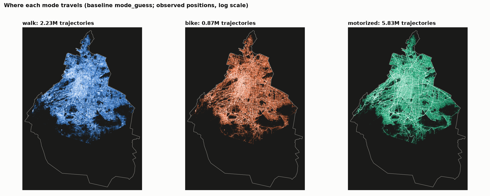

# Mexico City at scale

A full month of location data for Mexico City: **1.66 billion pings from 1.58 million
devices**, December 2022 (the `filtered_localized` quadrant dataset, 22 GB of parquet in 32
daily partitions). The runs use the gc-lbs MX configuration. Maps are clipped to the official
boundary of Ciudad de México (INEGI Marco Geoestadístico, `CVE_ENT = 09`).

!!! note "Coverage"
    The quadrant dataset is a bounding box that ends at 19.198° N. The southern rural part of
    the city (most of Tlalpan, Milpa Alta and Xochimilco) is outside it, so the south of every
    map is empty for lack of data, not because of the clipping.

## Step 1: remove coordinate sinks

Two-thirds of the devices have pings snapped to a handful of exact points: the city's default
geocode at the Zócalo (292k devices on 19.4326, -99.1332, plus a jitter grid around it), cell
towers and Wi-Fi positioning points. These pings create fake stays and homes and pull real
trips into straight lines toward those points. They are found and dropped first
([details](../guide/spatial.md#data-quality-coordinate-sinks)):

```python
import polaroam as pr

sinks = pr.find_sinks("/data/Berkeley/MX/data_quadrant/filtered_localized/*/*.parquet", min_devices=5000)
sinks.write_parquet("mx_sinks.parquet")          # 2,586 coordinates; 104 s
```

| Sinks (≥ 5,000 devices per exact coordinate) | |
|---|---|
| coordinates | 2,586 |
| pings dropped | 263,698,461 (15.9%) |
| devices with at least one dropped ping | 1,036,478 |

## Step 2: the pipeline

```python
cfg = pr.PipelineConfig.from_json(
    "pipeline_config.json", "MX", n_shards=24,
    trajectories=pr.TrajectoryParams(min_pings=2, min_length_m=100),
    drop_coordinates="mx_sinks.parquet",
)
pipe = pr.Pipeline("/data/out/MX_2022_12", cfg, trajectories=True, use_cuda=True)
pipe.run("/data/Berkeley/MX/data_quadrant/filtered_localized/*/*.parquet")
```

13.2 minutes on one RTX 3090, with a peak of 22.3 GB of RAM.

| Output | Without sinks | With sinks (gc-lbs behavior) |
|---|---|---|
| stays | 19,847,489 | 22,391,432 |
| trajectories (≥ 2 pings, ≥ 100 m) | 13,504,251 | 14,307,433 |
| devices with a home | 339,793 | 370,200 |
| devices with a work place | 53,885 | 58,766 |

## Where people stay

All 19.8M stays as points, rendered with [datashader](https://datashader.org) (aggregated per
pixel, histogram-equalised colors) and clipped to the city boundary:

{ width="640" }

## Homes and work places

The home and work location of every device that has one (`pipe.locations()`), same rendering.
Homes on coordinate sinks are excluded.


Homes cover the residential city; work places concentrate in the center and along the main
corridors. With one month of data (7 / 4 day thresholds), about one device in six with a home
also has a work place. For per-hexagon counts you can join with other data, see [Heat maps
with H3](../guide/spatial.md). Click any figure to enlarge it.

## Trajectories

Every observed position of the 13.5M trajectories (78M points: pings and stay anchors), as a
density raster. The street network appears from movement alone.

{ width="640" }

### By mode

The same, split by the baseline `mode_guess`:



- **Motorized** trips trace the road hierarchy: Periférico, Circuito Interior, Calzada de
  Tlalpan, Viaducto.
- **Bike** trips are densest in the center.
- **Walk** trips are local and diffuse.

| Mode | Trajectories | Median p85 | Median length |
|---|---|---|---|
| motorized | 5,825,143 | 40.7 km/h | 4.5 km |
| unknown | 4,587,279 | | 0.5 km |
| bike | 1,588,679 | 13.1 km/h | 1.5 km |
| walk | 1,503,150 | 1.3 km/h | 0.3 km |


!!! warning "Reading the mode baseline"
    - **Motorized** and **bike** have plausible cruising speeds and lengths.
    - **`walk`** has a median p85 of 1.3 km/h, below real walking: much of it is slow movement
      or drift near places.
    - **The longest motorized trips** (100+ km) are real: 4–8-hour drives at ~24 km/h, with no
      jumps, all over the city. These are the signature of taxi, ride-hailing and delivery
      drivers who never stop for the 5 minutes a stay needs.

    `mode_guess` is a baseline and a feature set, not ground truth. See [Speed and transport
    mode](../guide/speed-and-mode.md).

## How trajectories were fixed along the way

Two artifacts were found in this data and fixed in the library:

1. **Ping-pong between the true position and a fallback point, within minutes.** It produced
   103k "walks" longer than 100 km: median 3.4 minutes, 18 jumps each, straightness ≈ 0. GPS
   jumps (faster than `max_speed_kmh`) now split trajectories like long gaps do.
2. **Snapping to sink points at plausible speeds.** This drew straight spokes toward the sinks
   in the walk and bike maps. It is fixed at the source with `find_sinks` and
   `drop_coordinates`.

After both fixes, the longest walk is 34 km (it was 76,000 km), with a p99 of 6.7 km.

## Three ways, one answer

The same month was also processed all at once on CPU and GPU, and day by day, before the
trajectory speed features existed (sinks kept):

| Run | Wall time | Peak RAM | Peak GPU memory |
|---|---|---|---|
| One-shot, CPU | 24.4 min | 24.9 GB | |
| One-shot, GPU (RTX 3090) | **15.9 min** | 22.1 GB | 13.1 GB |
| 32 daily batches + `finalize` (CPU) | 40.5 min | **3.4 GB** | |

All three produced **identical** tables (stays, trajectories, clusters, home/work, locations),
compared exactly, row by row.

```python
# day by day
import glob

pipe = pr.Pipeline("/data/out/MX_2022_12_daily", cfg, trajectories=True)
for d in sorted(glob.glob("/data/Berkeley/MX/data_quadrant/filtered_localized/date_trunc=*")):
    pipe.update(f"{d}/*.parquet", batch_id=d.split("=")[-1], compute_home_work=False)
pipe.finalize()
```

## Reproduce the figures

```bash
python examples/mexico_city_figures.py /data/out/MX_2022_12            # maps, H3, trajectories by mode
python examples/mexico_city_figures.py /data/out/MX_2022_12 --modes    # speed / mode figure
```

The city boundary used for clipping is `examples/data/cdmx_boundary.geojson` (INEGI, simplified
to ~5 m).
