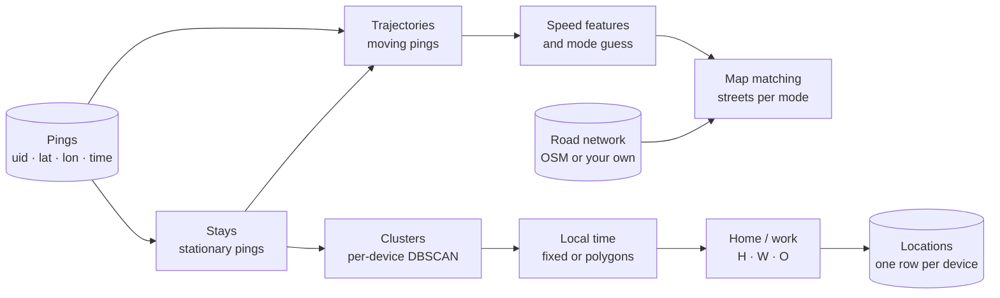

# User guide

PolaRoam follows the four stages of the gc-lbs pipeline and adds trajectories and transport
mode:

| Stage | Function | Incremental with | Page |
|---|---|---|---|
| Reading pings | `read_pings` (used by every stage) | | [Input data](input.md) |
| Stays | `detect_stops` | `StopDetector` | [Stays](stays.md) |
| Trajectories | `detect_stops(..., trajectories=True)` or `extract_trajectories` | `StopDetector(trajectories=True)` | [Trajectories](trajectories.md) |
| Speed and mode | computed with the trajectories, `guess_mode` | | [Speed and mode](speed-and-mode.md) |
| Map matching | `RoadNetwork`, `match_trajectories`, `edge_volumes` | per batch of trajectories | [Map matching](map-matching.md) |
| Clusters | `cluster_stops` | `IncrementalDBSCAN` | [Clustering](clustering.md) |
| Local time | `add_local_time` | (cheap, recomputed) | [Local time](local-time.md) |
| Home / work | `classify_home_work`, `home_work_locations` | (cheap, recomputed) | [Home and work](home-work.md) |
| Heat maps | `home_work_h3`, `h3_counts`, `coordinate_sinks` | | [Heat maps (H3)](spatial.md) |
| All of the above | `Pipeline.run`, `Pipeline.update` | `Pipeline.update` | [The pipeline](pipeline.md) |

Two principles run through the implementation:

**Everything is column-wise.** No step loops over devices in Python (`map_groups`). Previous
rows become shifts masked where the device changes, groups become `group_by` and `over`
windows, and neighbor searches become joins. Polars runs all of it in parallel, and the same
queries run on the GPU engine.

**Same answer, whatever the route.** One run over all the data, day-by-day batches in any
split, any number of shards, CPU or GPU: all give identical tables. The [test
suite](../validation/testing.md) checks this, and so did a full month of Mexico City (1.66B
pings, [benchmarks](../validation/benchmarks.md)).
