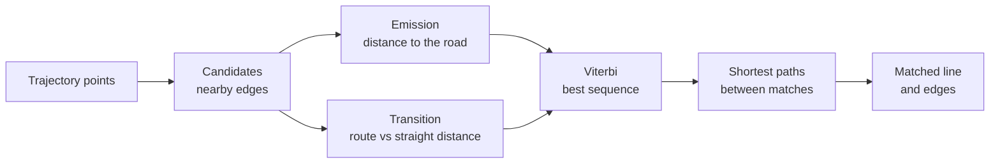

# Map matching

Trajectories follow the pings, and pings are noisy: they sit inside buildings, cut corners and
jump across blocks. **Map matching** snaps each trajectory to a road network, so it follows
streets the way the device actually could, and tells you which street segments it used. With
that you can count trips per street, compare routes, or build volumes per mode.

```python
import polars as pl
import polaroam as pr

# your streets: any table of LineStrings (OpenStreetMap, a city's centerlines...)
net = pr.RoadNetwork(pl.read_parquet("streets.parquet"))

# trajectories with every ping (simplify_tolerance=0) give the best matches
trips = pr.extract_trajectories(pings, stops, simplify_tolerance=0, min_pings=2, min_length_m=100)
res = pr.match_trajectories(trips, net)

res.trajectories   # one row per trajectory: matched line (WKT), length, quality
res.points         # each ping's matched position, street segment and distance to it
res.edges          # every street segment traversed, in order
pr.edge_volumes(res.edges, net)   # trajectories per street segment
```

## One network per mode

People walk, cycle and drive on different networks: footpaths and pedestrian streets, bike
lanes, one-way streets. Pass a network per value of `mode_guess` (or any column, with `by=`):

```python
nets = {
    "walk": pr.RoadNetwork(pl.read_parquet("osm/walk.parquet"), directed=True),
    "bike": pr.RoadNetwork(pl.read_parquet("osm/bike.parquet"), directed=True),
    "motorized": pr.RoadNetwork(pl.read_parquet("osm/drive.parquet"), directed=True),
}
res = pr.match_trajectories(trips, nets)               # unknown-mode trajectories are skipped
vol = pr.edge_volumes(res.edges, by="mode_guess")
```

## Your road network

`RoadNetwork` takes one row per road edge with a LineString `geometry` (WKB, WKT or shapely
objects); every other column (`highway`, `name`, `maxspeed`...) is kept and comes back with the
traversed edges.

| Your data | How to load it |
|---|---|
| Street centerlines, split at intersections | `RoadNetwork(df)`: nodes are the line endpoints; every street is two-way unless its `oneway` column is true |
| A routing graph with node ids | `RoadNetwork(df, u="from_node", v="to_node")` |
| One row per direction (osmnx edges) | `RoadNetwork(df, directed=True)` |
| An osmnx graph | `RoadNetwork.from_osmnx(G)` |
| A parquet or CSV file | `RoadNetwork.read("streets.parquet", directed=True)` |

To download OpenStreetMap for a city with [osmnx](https://osmnx.readthedocs.io) (an extra
dependency, only for this step):

```python
import osmnx as ox
G = ox.graph_from_place("Ciudad de México, Mexico", network_type="drive")   # or "bike", "walk"
net = pr.RoadNetwork.from_osmnx(G)
```

`examples/download_osm.py` saves the drive, bike and walk networks of a polygon as parquet
files. OpenStreetMap data is © OpenStreetMap contributors, under the ODbL.

## How it works

polaroam uses the hidden Markov model of Newson and Krumm (2009), the standard for this task:



1. **Candidates.** Each point is projected onto the road edges within `search_radius`, keeping
   the `max_candidates` nearest. The search is a grid join, like the clustering, over the
   edges cut into short pieces.
2. **Emission.** A candidate $d$ meters from its point scores $-\frac{1}{2}(d/\sigma)^2$: close
   roads are likelier.
3. **Transition.** Between consecutive points, the route distance on the network between two
   candidates is compared with the straight distance $g$ between the points:
   $-|\text{route} - g| / \beta$. Real movement follows roads, so the two are close. Routes
   longer than `route_factor` × $g$ + 2 × `search_radius`, or faster than `max_speed_kmh`, are
   impossible.
4. **Viterbi.** The best sequence of candidates is found for every trajectory at once.
5. **Paths.** Consecutive matches are joined by their shortest path on the network; that path
   gives the matched line and the edges traversed.

Two details matter with location data:

- **Standing still.** A slow or stopped device jitters back and forth along a street. On a
  one-way street, a few meters backwards would mean driving around the block, so small steps
  back on the same edge (up to `backtrack_m`) count as standing still.
- **Gaps the network cannot explain.** If no route connects two consecutive points (a jump, a
  missing street, a ferry), matching restarts there: the trajectory has several matched parts
  (`n_parts`) and its line is a MULTILINESTRING. Points with no road within `search_radius`
  are skipped.

### Performance

The matching is vectorized like the rest of polaroam. Candidates and transitions are Polars
joins over all trajectories, and the two sequential parts run as compiled numba kernels:

- **Routing** runs a bounded Dijkstra from each needed node. It stops once its targets are
  reached (or past the longest possible route), and resets only the nodes it touched, so its
  cost depends on the neighbourhood explored, not on the size of the network. Sources run in
  parallel.
- **Viterbi** runs one trajectory per task, all in parallel.

On a 90,000-node grid, 425,000 points match in about 9 s on 32 cores. On Mexico City's
OpenStreetMap networks, 11.7M points match in 8.8 minutes (22,000 points per second). The large
joins (points × nearby road pieces, candidate pairs) run in Polars' streaming engine, and
trajectories are processed in chunks of `chunk_points` points, so memory stays bounded: all the
walk trajectories of the Mexico City example (2.3M points, 535,000 edges) peak at 5.7 GB. The
results themselves can be large (about 4 traversed edges per point), so match big datasets in
batches and write each result.

## Parameters

| Parameter | Default | Meaning |
|---|---|---|
| `search_radius` | 80 m | roads farther from a point are not candidates |
| `max_candidates` | 12 | nearest directed edges kept per point |
| `sigma` | 20 m | GPS noise, for the emission |
| `beta` | 100 m | tolerance for route minus straight distance, for the transition |
| `route_factor` | 5 | a route longer than this × the straight distance (+ 2 × radius) is impossible |
| `max_speed_kmh` | None | a route faster than this between two pings is impossible |
| `backtrack_m` | 40 m | a step back on the same edge up to this is standing still |
| `chunk_points` | 200,000 | points per chunk (memory) |

The defaults are tuned for LBS data, which is noisier than dedicated GPS. On a sample of
motorized trajectories from one month of Mexico City, the textbook GPS settings (50 m radius, 8
candidates, factor 3) matched 72% of trajectories in one piece; these defaults match 86%.

```python
res = pr.match_trajectories(trips, net, search_radius=60, max_speed_kmh=130)
```

```bash
polaroam match trips.parquet matched/ --network walk=osm/walk.parquet \
    --network bike=osm/bike.parquet --network motorized=osm/drive.parquet --directed
```

## Outputs

**`res.trajectories`**: one row per input trajectory.

| Column | Description |
|---|---|
| `uid`, `trajectory_id` (+ `mode_guess`) | the trajectory |
| `n_points`, `n_matched` | points, and points with a road within the search radius |
| `n_parts` | matched parts: 1 normally, more after a gap, 0 if nothing could be matched |
| `matched_length_m` | length of the matched route |
| `mean_distance_m` | mean distance from the points to their matched positions |
| `geometry` | matched line, WKT `LINESTRING` (or `MULTILINESTRING` with several parts) |

**`res.points`**: `uid, trajectory_id, step, timestamp, longitude, latitude,
matched_longitude, matched_latitude, edge, offset_m, distance_m, part`.

**`res.edges`**: every traversed edge in order (`seq`), with the covered stretch (`from_m`,
`to_m`), the edge `length_m`, and your network's columns (`u`, `v`, `highway`, `name`...). A
trajectory's edges are consecutive on the network within each part.

**`pr.edge_volumes(res.edges, net, by="mode_guess")`**: trajectories per edge (each
trajectory counted once per edge), optionally with the edge geometry.
