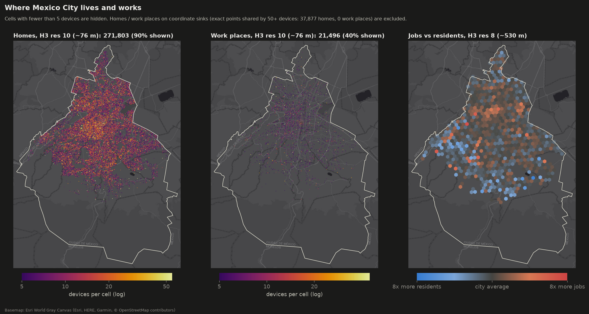

# Heat maps with H3

Homes, work places and stays can be aggregated on [H3](https://h3geo.org) hexagons with
`polaroam.h3`, through the Polars-native [polars-h3](https://github.com/Filimoa/polars-h3)
plugin (`pip install -e ".[h3]"`, Python ≥ 3.11).

```python
cells = pr.home_work_h3(pipe.locations(), resolution=10)       # homes and workers per cell
cells = pipe.locations_h3(resolution=10)                         # the same, from a pipeline

stays = pr.h3_counts(pipe.stops(), "stop_latitude", "stop_longitude", resolution=9)
```

Each row has the cell id (`h3_cell`, UInt64, and `h3_index`, the usual hex string), its center
and a WKT `POLYGON`. The output opens directly in QGIS or GeoPandas:

```python
import geopandas as gpd

gdf = gpd.GeoDataFrame(cells.to_pandas(), geometry=gpd.GeoSeries.from_wkt(cells["geometry"].to_list()),
                       crs="EPSG:4326")
```

## k-anonymity

Fine resolutions isolate individuals: at resolution 10 a cell can hold a single home. **Cells
with fewer than `min_count` devices (default 5) are dropped.** In `home_work_h3`, a count below
`min_count` is set to null, and the cell is dropped when both counts are null.
`min_count=1` disables the protection, for internal use only.

How much survives depends on resolution and density. In one month of Mexico City (302k homes
and 53.9k work places after removing coordinate sinks), with k = 5:

| H3 res | Hexagon edge | Homes kept | Workers kept |
|---|---|---|---|
| 8 | ~531 m | 100% | 100% |
| 9 | ~201 m | 100% | 91% |
| 10 | ~76 m | 90% | 40% |
| 11 | ~29 m | 58% | 18% |

Homes support block-level maps (res 10–11). Work places are far fewer: at res 10 the map keeps
only the densest job areas (40% of workers), and res 9 shows 91%.



The right panel compares jobs with residents per res-8 cell. It plots
\(\log_2\big((\text{workers}_c / W) / (\text{homes}_c / H)\big)\), where \(W\) and \(H\) are
the city totals: red cells have more jobs than residents relative to the city, blue cells the
opposite. A coarse resolution keeps both counts above k everywhere. At finer resolutions,
requiring ≥ k workers would select only job-dense cells and bias the map red.

## Data quality: coordinate sinks

Some exact coordinates are shared by thousands of unrelated devices: a city's default geocode
(used when only the IP or the cell is known), cell towers, Wi-Fi positioning points. Pings
snapped there create fake stays and homes, and they pull real trips into straight "spokes"
toward those points. No speed test catches them: a snap to a point 5 km away ten minutes later
looks like 30 km/h.

**Find them and drop those pings before anything else:**

=== "Python"

    ```python
    sinks = pr.find_sinks("raw/MX/**/*.parquet", min_devices=5000)    # two streaming passes
    sinks.write_parquet("mx_sinks.parquet")

    cfg = pr.PipelineConfig(timezone="America/Mexico_City", drop_coordinates="mx_sinks.parquet")
    ```

=== "Command line"

    ```bash
    polaroam sinks "raw/MX/**/*.parquet" mx_sinks.parquet --min-devices 5000
    polaroam run "raw/MX/**/*.parquet" out/MX --drop-coordinates mx_sinks.parquet ...
    ```

`drop_coordinates` is opt-in: it deliberately departs from gc-lbs, which keeps every ping. The
list is fixed for an output directory, so incremental runs stay consistent.

!!! tip "Choosing `min_devices`"
    Coordinates are often rounded to ~1 m. Over a month with ~1.6M devices, real busy places
    (metro stations, malls) collect hundreds or thousands of devices on the same rounded
    point, so a low threshold removes real data. In Mexico City:

    - **≥ 50 devices** matched 270k coordinates and 61% of all pings, far too aggressive.
    - **≥ 5,000** (2,586 coordinates) captured the snapping points: the Zócalo default geocode
      (292k devices on 19.4326, -99.1332, plus a jitter grid of ~143k-device neighbors) and the
      centers of the trajectory spokes (6.5k–17k devices each).

    Inspect `find_sinks(..., min_devices=50)` sorted by `devices` and pick the threshold where
    your known artifacts start.

For already computed tables, `coordinate_sinks` / `drop_sinks` work on any coordinates, e.g.
homes:

```python
sinks = pr.coordinate_sinks(pipe.locations(), "home_latitude", "home_longitude", min_devices=50)
clean = pr.drop_sinks(pipe.locations(), sinks, "home_latitude", "home_longitude")
```
